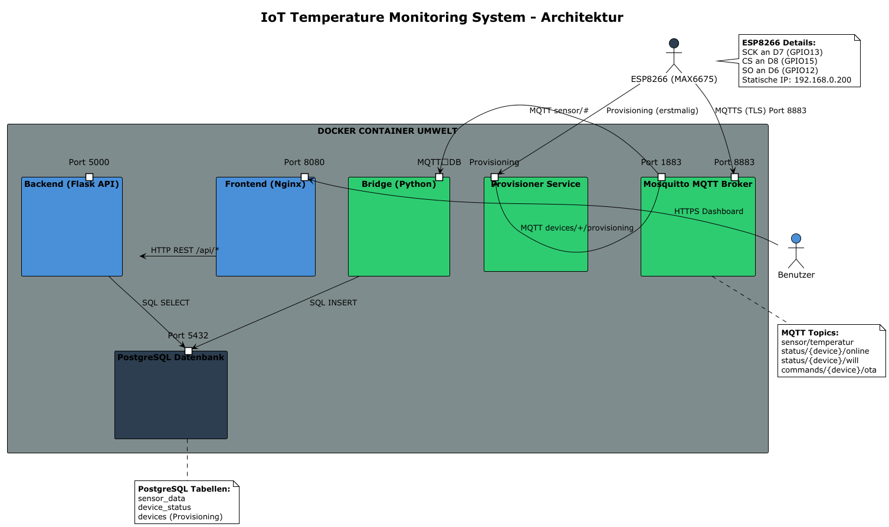
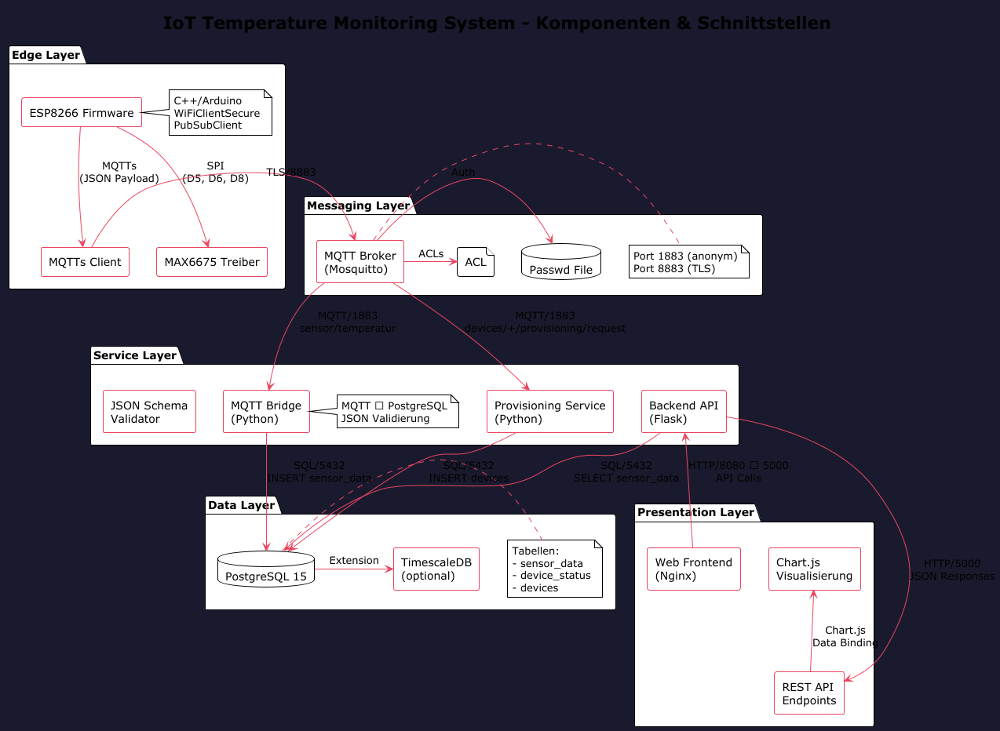
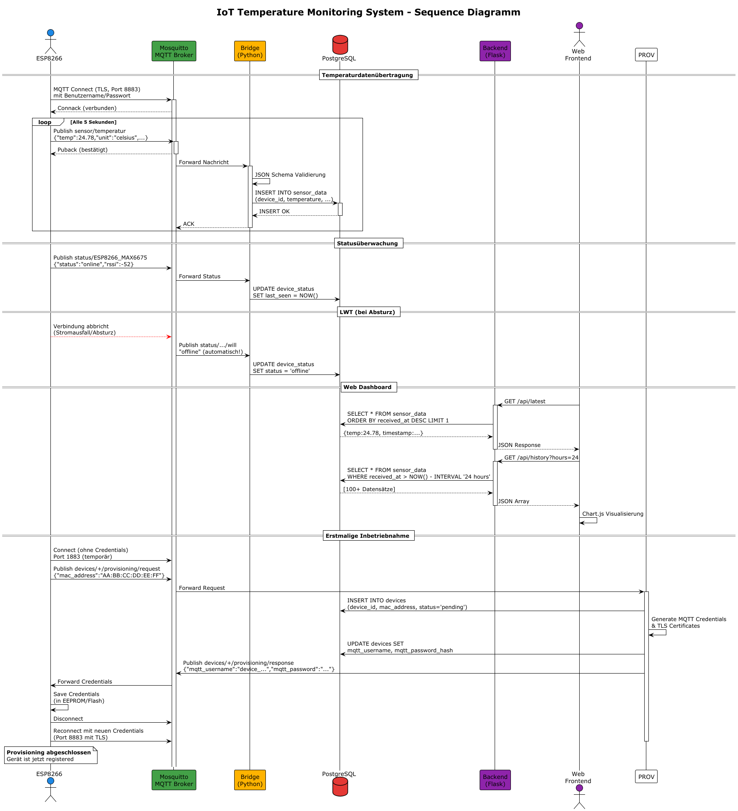
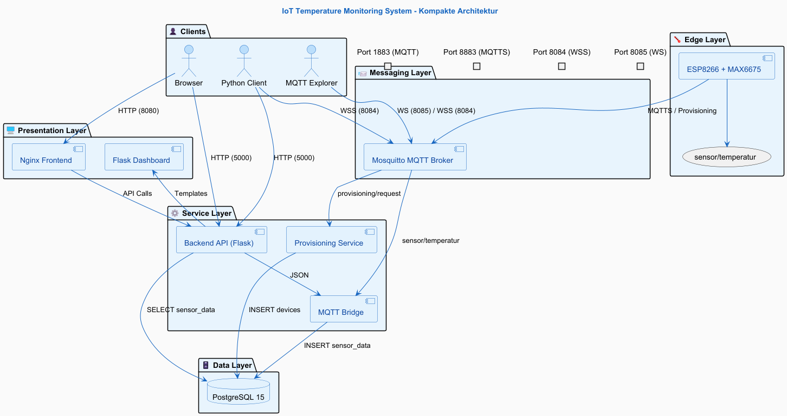
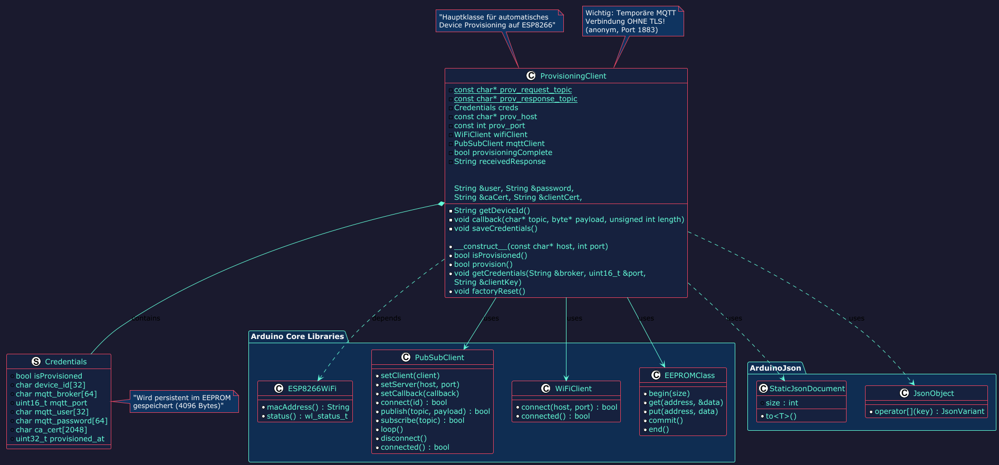
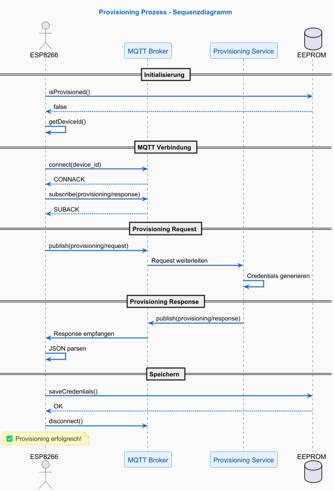
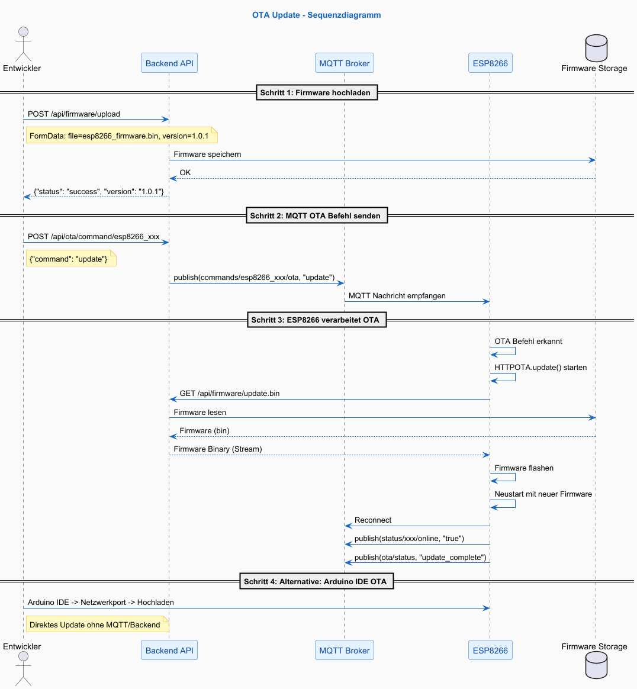
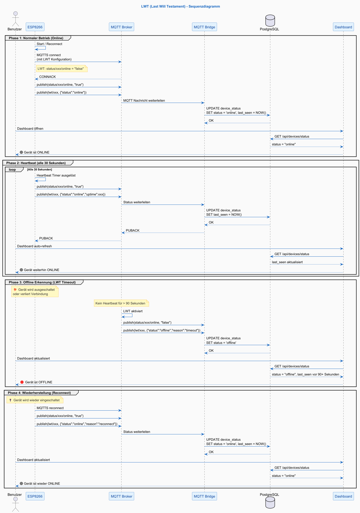

# 🌡️ IoT Temperature Monitoring System

Ein vollständiges IoT-System zur Überwachung von Temperaturen mit ESP8266, MAX6675 Thermoelement-Sensor und einer Docker-basierten Microservices-Architektur.

## 📋 Inhaltsverzeichnis

- [Überblick](#überblick)
- [Architektur](#architektur)
- [Technologie-Stack](#technologie-stack)
- [Schnittstellen](#schnittstellen)
- [Voraussetzungen](#voraussetzungen)
- [Installation](#installation)
- [Konfiguration](#konfiguration)
- [Betrieb](#betrieb)
- [API Dokumentation](#api-dokumentation)
- [Fehlersuche](#fehlersuche)
- [Erweiterungsmöglichkeiten](#erweiterungsmöglichkeiten)

## 🎯 Überblick

Das System ermöglicht die automatische Erfassung, Übertragung und Visualisierung von Temperaturdaten. Ein ESP8266 mit MAX6675 Sensor sendet die Daten verschlüsselt via MQTTS an einen Mosquitto Broker. Eine Bridge speichert die Daten in PostgreSQL, während ein Flask-Backend und Nginx-Frontend die Visualisierung übernehmen.

### Hauptmerkmale

- ✅ **Automatisches Provisioning** - Neue Geräte werden automatisch registriert
- 🔒 **Verschlüsselte Kommunikation** - TLS für MQTT (Port 8883)
- 📊 **Echtzeit-Dashboard** - Live-Temperaturanzeige mit Chart.js
- 🗄️ **Persistente Speicherung** - PostgreSQL mit TimescaleDB-Option
- 🐳 **Containerisiert** - Vollständige Docker-Compose Umgebung
- ⏰ **Lokale Zeitzone** - Alle Zeitstempel in Europe/Berlin (CET/CEST)

## 🏗️ Architektur

### Komponentendiagramm

## 📊 Systemarchitektur

    
    
<em>Überblick über die gesamte Systemarchitektur</em>

## 🔌 Komponenten & Schnittstellen

    
    
<em>Detaillierte Komponenten mit allen Schnittstellen</em>

## 🐳 Docker Deployment

    
    
<em>Container-Deployment mit Netzwerkverbindungen</em>

## Sequenzdiagramm

    
    
<em>Sequenzdiagramm mit allen Schnittstellen</em>

## IoT Temperature Monitoring Gesamt-System Kompakte Architektur

    
    
<em>Gesamt-System Kompakte Architektur</em>

## Klassendiagramm:Provisioning.h

    
    
<em>Klassendiagramm: Provisioning</em>

## Provisioning Prozess Sequenzdiagramm

    
    
<em>Sequenzdiagramm: Provisioning</em>

## OTA interface Update Sequenzdiagramm

    
    
<em>Sequenzdiagramm: OTA Update</em>

## LWT Last Will Testament Sequenzdiagramm

    
    
<em>Sequenzdiagramm: LWT</em>

## Technologie-Stack

* Komponente	Technologie	Version	Port
Edge Device	ESP8266 + MAX6675 und
Firmware Arduino C/C++	
* MQTT Broker	Eclipse Mosquitto	2.0	1883, 8883
Provisioning	Python + Paho MQTT	3.11	
* Bridge	Python + Paho MQTT	3.11	
* Backend API	Flask + CORS	2.3.3	5000
* Frontend	Nginx + HTML/JS	latest	8080
* Database	PostgreSQL	15	5432
* Visualisierung	Chart.js	4.x	
* Container	Docker + Compose	24.x	

## Detaillierte Technologie:

* Edge Device			
	ESP8266	ESP-12E	WiFi Mikrocontroller

*	Arduino Framework	3.1.2	C++ Entwicklungsumgebung

*	MAX6675: 	K-Type Thermoelement Verstärker
*	K-Type Thermoelement	-	Temperatursensor (-50 bis +600°C)
* Kommunikation:	MQTT 5.0 Messaging Protokoll
	MQTTS: 	MQTT mit TLS Verschlüsselung
*	WebSocket Secure (WSS):	Browser MQTT Verbindung
*	SPI	:	Sensor-Kommunikation
* Backend Services: Python	3.11 Hauptprogrammiersprache
	Flask 2.3.3	Web Framework für API
	Flask-CORS	4.0.0	Cross-Origin Resource Sharing
* Paho-MQTT	1.6.1	MQTT Client Bibliothek
* Psycopg2	2.9.9	PostgreSQL Adapter
* ArduinoJson 6.21.3 JSON Parsing für ESP8266
* PubSubClient	2.8.0	MQTT Client für ESP8266

* Datenbank: PostgreSQL	15	Relationale Datenbank
	TimescaleDB	2.12 (optional)	Zeitreihen-Erweiterung
* Frontend HTML5, Struktur CSS3	Styling, JavaScript (ES6)    Interaktivität Chart.js 4.4 für Diagramme & Visualisierung, Nginx	1.24: Static Webserver
  
* Containerisierung: Docker	24.x Container Runtime,
	Docker Compose	2.20: Multi-Container Orchestrierung

* Sicherheit: OpenSSL 3.x TLS Zertifikate,
	Mosquitto ACL: Zugriffskontrolle (Least-Privilege)
	mTLS (optional)	Gegenseitige Zertifikatsprüfung

* Entwicklung:
  VS-Code, Arduino IDE, Git: Version Control, GitHub: Repository Hosting

* API & Protokolle: REST API, HTTP/JSON Schnittstelle, MQTT Publish/Subscribe Messaging, WebSocket: Bidirektionale Browser-Kommunikation, SQL: Datenbankabfragen
  
### OTA Updates

    MQTT Topic: commands/{device_id}/ota

* HTTP OTA via Backend:
* Mit curl (PowerShell)
curl -X POST http://192.168.0.105:5000/api/firmware/upload -F "file=@firmware.bin" -F "version=1.0.1"

* Response erwartet: {"status":"success","message":"Firmware uploaded successfully","version":"1.0.1"}
  
* Bridge Logs (sieht OTA Status?)
docker logs mqtt_bridge --tail 20

* Backend Logs (sieht OTA API Calls?)
docker logs api_backend --tail 20  

#### Fehlerbehebung OTA:

#### Problem und Lösung:

* OTA Verbindung fehlgeschlagen: Prüfe ob ESP8266 und PC im gleichen Netzwerk sind
* Passwort falsch: Prüfe ota_config.h Passwort
* Firmware Download fehlgeschlagen:	Prüfe ob Backend läuft (curl http://192.168.0.105:5000/api/health)
* MQTT Befehl nicht empfangen: Prüfe mit MQTT Explorer ob Nachricht ankommt
* Update hängt bei 0%: Prüfe Speicherplatz des ESP8266 (heap)

## 🔌 Schnittstellen
### 1. MQTT Schnittstellen
* Provisioning Topics
Topic	Richtung	Beschreibung	Payload
provisioning/request	ESP → Provisioner	Anfrage für neue Credentials	
{"mac_address":"...", "device_id":"...", "firmware_version":"..."}
* provisioning/response	Provisioner → ESP	Antwort mit Credentials	{"status":"success", "mqtt_username":"...", "mqtt_password":"...", "mqtt_broker":"...", "mqtt_port":8883}
* Sensor Topics
Topic	Richtung	Beschreibung	Payload
sensor/temperatur	
* ESP → Bridge	Temperaturdaten	{"device_id":"...", "device_type":"esp8266", "sensor":"max6675", "temp":25.5, "unit":"celsius", "rssi":-59, "heap":18840, "uptime":6}
  
* Status Topics: Topic	Richtung: Beschreibung
status/{device_id}/online	
* ESP → Broker	Gerät ist online 
* status/{device_id}/will	
* ESP → Broker	Last Will Nachricht
  
### 2. REST API Endpoints (Port 5000)
* Methode	Endpoint	Beschreibung	Response
GET	/api/latest	Aktuellste Temperatur	{"device_id":"...", "temperature":25.5, "unit":"celsius", "timestamp":"2026-04-17 10:30:00"}
* GET	/api/history?hours=24&limit=200	Historische Daten	[{"device_id":"...", "temperature":25.5, "timestamp":"..."}]
* GET	/api/devices	Alle registrierten Geräte	[{"device_id":"...", "status":"online", "last_seen":"..."}]
* GET	/api/stats?hours=24	Statistiken	{"min_temp":23.5, "max_temp":25.8, "avg_temp":24.6, "count":288}
* GET	/api/health	Health Check	{"status":"healthy", "database":"connected", "timezone":"Europe/Berlin"}
* GET	/	Dashboard HTML für HTML Seite

## Datenbank Schema

### sensor_data Tabelle
sql

* CREATE TABLE sensor_data (
    id BIGSERIAL PRIMARY KEY,
    device_id VARCHAR(64) NOT NULL,
    device_type VARCHAR(32),
    sensor_type VARCHAR(32),
    value DECIMAL(10,2),
    unit VARCHAR(16),
    raw_payload JSONB,
    received_at TIMESTAMPTZ DEFAULT NOW()
);

* device_status Tabelle sql
  

* CREATE TABLE device_status (
    device_id VARCHAR(64) PRIMARY KEY,
    status VARCHAR(20) DEFAULT 'offline',
    last_seen TIMESTAMPTZ,
    last_rssi INTEGER,
    last_free_heap INTEGER,
    updated_at TIMESTAMPTZ
);

* devices Tabelle (Provisioning) sql

* CREATE TABLE devices (
    id SERIAL PRIMARY KEY,
    device_id VARCHAR(64) UNIQUE NOT NULL,
    mac_address VARCHAR(17) UNIQUE NOT NULL,
    mqtt_username VARCHAR(64) UNIQUE,
    mqtt_password_hash VARCHAR(255),
    status VARCHAR(20) DEFAULT 'pending',
    provisioned_at TIMESTAMPTZ DEFAULT NOW()
);

## Docker Volumes & Bind Mounts
* Volume/Mount	Container Beschreibung: postgres_data	postgres_db	Persistente Datenbankdateien
  
* ./mosquitto/config:/mosquitto/config	mqtt_broker	Mosquitto Konfiguration
./mosquitto/passwd:/mosquitto/passwd: mqtt_broker	Passwortdatei
* ./certs:/mosquitto/certs:ro mqtt_broker TLS Zertifikate
* ./certs:/app/certs:ro	provisioner	CA Zertifikate

## 💻 Voraussetzungen

    Docker Desktop (Version 24.0+)

    Docker Compose (Version 2.20+)

    Git (für Repository)

    ESP8266 mit MAX6675 Modul

    Windows/Linux/Mac als Host-System

    Python 3.11+ (für lokale Entwicklung)

## 🚀 Installation
### 1. Repository klonen
bash

git clone https://github.com/dein-benutzername/IOT-Temperature-System.git
cd IOT-Temperature-System

### 2. Umgebungsvariablen konfigurieren

Erstelle eine .env Datei:
env

## Datenbank
DB_PASSWORD=dein_sicheres_passwort

## MQTT Benutzer
* MQTT_BRIDGE_USER=bridge_user
MQTT_BRIDGE_PASSWORD=bridge_passwort
* MQTT_PROVISION_USER=provisioner
MQTT_PROVISION_PASSWORD=provisioner_passwort

## Broker Adresse (IP des Hosts)
MQTT_BROKER_ADDRESS=192.168.0.105

## 3. TLS Zertifikate generieren
bash

* cd certs
* openssl genrsa -out ca.key 2048
* openssl req -new -x509 -days 365 -key ca.key -out ca.crt -subj "/CN=MQTT-CA"
* openssl genrsa -out server.key 2048
* openssl req -new -key server.key -out server.csr -subj "/CN=192.168.0.105"
* openssl x509 -req -days 365 -in server.csr -CA ca.crt -CAkey ca.key -set_serial 01 -out server.crt
cd ..

## 4. Docker Container starten
bash

docker-compose up -d

## 5. ESP8266 Firmware flashen

    Öffne main.ino in Arduino IDE

    Installiere benötigte Bibliotheken:

        PubSubClient

        ArduinoJson

        MAX6675

    Kompiliere und flashe auf ESP8266

## ⚙️ Konfiguration
### Mosquitto Konfiguration (mosquitto/config/mosquitto.conf)
conf

listener 1883 0.0.0.0
allow_anonymous true

listener 8883 0.0.0.0
allow_anonymous false
certfile /mosquitto/certs/server.crt
keyfile /mosquitto/certs/server.key
cafile /mosquitto/certs/ca.crt
require_certificate false

password_file /mosquitto/passwd/passwd_file

### ESP8266 Konfiguration (main.ino)
cpp

* // WLAN
const char* WLAN_SSID = "Dein_WLAN";
const char* WLAN_PASSWORT = "Dein_Passwort";

* // Statische IP
IPAddress staticIP(192, 168, 0, 200);
IPAddress gateway(192, 168, 0, 1);
IPAddress subnet(255, 255, 255, 0);

* // Provisioning Service
const char* PROVISIONING_HOST = "192.168.0.105";
const int PROVISIONING_PORT = 1883;

### Konfiguration in Provisioning.h:
   
* strlcpy(creds.device_id, device_id.c_str(), sizeof(creds.device_id));
strlcpy(creds.mqtt_broker, doc["mqtt_broker"] | "192.168.0.105", sizeof(creds.mqtt_broker));
creds.mqtt_port = doc["mqtt_port"] | 8883;
strlcpy(creds.mqtt_user, doc["mqtt_username"] | "", sizeof(creds.mqtt_user));
strlcpy(creds.mqtt_password, doc["mqtt_password"] | "", sizeof(creds.mqtt_password));

## 🔧 Betrieb
Container Management
bash

### Alle Container starten
docker-compose up -d

### Container stoppen
docker-compose down

### Logs anzeigen
docker-compose logs -f

### Einzelnen Service neu starten
docker-compose restart bridge

### Container neu bauen
docker-compose build --no-cache bridge

### Docker Container bauen
docker-compose build

### Backup Datenbank
docker exec postgres_db pg_dump -U sensor_user sensordb > backup.sql

### Dashboard Zugriff:

Service	URL	Beschreibung
Backend Dashboard	http://192.168.0.105:5000	Vollständiges Dashboard mit Diagramm
Frontend Dashboard	http://192.168.0.105:8080	Einfaches Dashboard
API Health Check	http://192.168.0.105:5000/api/health	Statusabfrage
Datenbank Abfragen
bash

### Öffne die HTML WSS-Datei im Browser
start "file:///C:/Users/User/Desktop/Ye_SIC/IOT-Temperature-System/wss-demo/html/wss-all-browser.html"

Host: 192.168.0.105

Port: 8084

### WSS Über Python Client
python wss_client_secure.py

### WSS Über MQTT Explorer
Protocol: ws://

Host: 192.168.0.105

Port: 8084

TLS aktivieren (im Advanced)

### Letzte 10 Messungen
docker exec postgres_db psql -U sensor_user -d sensordb -c "SELECT device_id, value, received_at FROM sensor_data ORDER BY id DESC LIMIT 10;"

### Durchschnittstemperatur letzte Stunde
docker exec postgres_db psql -U sensor_user -d sensordb -c "SELECT AVG(value) FROM sensor_data WHERE received_at > NOW() - INTERVAL '1 hour';"

### Gerätestatus
docker exec postgres_db psql -U sensor_user -d sensordb -c "SELECT * FROM device_status;"

### Zeige alle gespeicherten Temperaturdaten
docker exec postgres_db psql -U sensor_user -d sensordb -c "SELECT COUNT(*) as total_measurements FROM sensor_data;"

### Zeige die letzten 10 Messungen
docker exec postgres_db psql -U sensor_user -d sensordb -c "SELECT device_id, value, unit, received_at FROM sensor_data ORDER BY id DESC LIMIT 10;"

### Zeige Statistik
docker exec postgres_db psql -U sensor_user -d sensordb -c "SELECT MIN(value) as min_temp, MAX(value) as max_temp, AVG(value) as avg_temp FROM sensor_data;"

### Zeige Gerätestatus
docker exec postgres_db psql -U sensor_user -d sensordb -c "SELECT * FROM device_status;"

### Zeige 100 Sensor Daten
docker exec postgres_db psql -U sensor_user -d sensordb -c "SELECT* from sensor_data ORDER BY id DESC LIMIT 100;"

### Zeige die Tabellenstruktur
docker exec postgres_db psql -U sensor_user -d sensordb -c "\dt"

## 📖 API Dokumentation
GET /api/latest

Response:
json

{
    "device_id": "esp8266_ECFABC5F0",
    "temperature": 23.5,
    "unit": "celsius",
    "timestamp": "2026-04-17 10:30:00",
    "timezone": "Europe/Berlin"
}

GET /api/history

Parameter:

    hours (optional, default: 24) - Zeitraum in Stunden

    limit (optional, default: 200) - Maximale Anzahl

Response:
json

[
    {
        "device_id": "esp8266_ECFABC5F0",
        "temperature": 23.5,
        "unit": "celsius",
        "timestamp": "2026-04-17 10:25:00"
    }
]

GET /api/stats

Parameter:

    hours (optional, default: 24)

Response:
json

{
    "min_temp": 23.2,
    "max_temp": 24.8,
    "avg_temp": 23.9,
    "count": 288
}

## 🐛 Fehlersuche
Bridge startet nicht (pytz fehlt)
bash

docker-compose build --no-cache bridge
docker-compose up -d bridge

MQTT Verbindungsfehler (rc=-2)
bash

### Prüfe ob Mosquitto läuft
docker ps | findstr mqtt

### Prüfe Logs
docker logs mqtt_broker --tail 30

### Teste TLS Verbindung
docker exec mqtt_broker mosquitto_sub -t "test" -u test_device -P test_password_123 --cafile /mosquitto/certs/ca.crt -p 8883

Keine Daten in der Datenbank
bash

### Prüfe Bridge Logs
docker logs mqtt_bridge --tail 50

### Prüfe ESP8266 Verbindung
docker logs mqtt_broker --tail 20 | findstr "esp8266"

### Sende manuelle Test-Nachricht
docker exec mqtt_broker mosquitto_pub -t "sensor/temperatur" -m '{"device_id":"test","temp":25.5}' -u test_device -P test_password_123 -p 1883

Factory Reset für ESP8266

Sende RESET über den Seriellen Monitor (115200 Baud).

### Performance-Kennzahlen:
Metrik:	
* Temperatur-Abtastrate	5 Sekunden
* Heartbeat Intervall	30 Sekunden
* LWT Timeout	90 Sekunden
* MQTT Message Größe	~150 Bytes
* ESP8266 RAM Nutzung	~30-40 KB
* Datenbank Zeilen/Tag	~17.280 (bei 1 Gerät)
* API Response Zeit	< 50 ms
* Dashboard Update	10 Sekunden

## 🔮 Erweiterungsmöglichkeiten
1. Mehrere Sensoren

    Einfach weitere ESP8266 hinzufügen

    Automatisches Provisioning pro Gerät

2. Alarme & Benachrichtigungen
python

### Beispiel für E-Mail Alarm bei Temperaturschwelle
if temperature > 30.0:
    send_email_alert("Hohe Temperatur!", temperature)

3. Grafana Integration
yaml

grafana:
  image: grafana/grafana:latest
  ports:
    - "3000:3000"
  volumes:
    - grafana_data:/var/lib/grafana

4. InfluxDB + TimescaleDB
yaml

timescaledb:
  image: timescale/timescaledb:latest-pg15
  environment:
    POSTGRES_DB: sensordb

## 📄 Lizenz

MIT License - Siehe LICENSE Datei

👥 Autoren

    Nouridini Degbembia 

🙏 Danksagung

    ESP8266 Community

    Eclipse Mosquitto Team

    Flask & PostgreSQL Entwickler

